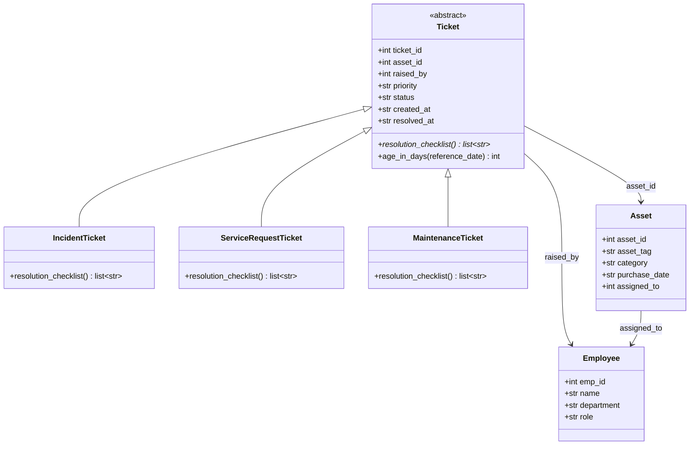
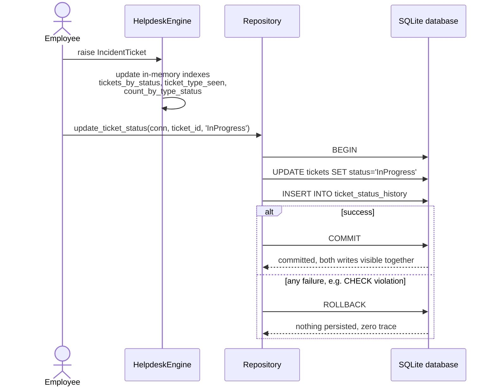

# SentinelDesk Design Document (HLD / LLD / Scale-Readiness)

Audience: the platform-review board deciding whether SentinelDesk enters
limited rollout. Everything below names real artifacts in this repository.

---

## 1. High-Level Design

SentinelDesk follows the classic four-layer pattern (Presentation ->
Business -> Data Access -> Database), mapped onto the actual code:

| Layer | Artifact | Responsibility |
|---|---|---|
| **Presentation** | The CLI surface: `python engine.py`, `python repository.py`, `python run_concurrency_experiment.py`, and the `reports/*.sql` files run through the `sqlite3` shell (all driven by `README.md`) | The only user-facing surface in this build: scripts that print engine state, the atomicity trace, the concurrency experiment, and report output. There is no GUI on purpose; the README-driven CLI is the presentation layer here, such as it is. |
| **Business** | `engine.py`: `HelpdeskEngine` plus the `Ticket` / `IncidentTicket` / `ServiceRequestTicket` / `MaintenanceTicket` hierarchy (and `Employee` / `Asset` carriers) | Domain rules: what a ticket *is*, what each ticket type's `resolution_checklist()` requires, `age_in_days()`, and the in-memory indexes (`tickets_by_status`, `count_by_type_status`, and friends) that answer lookups without re-querying the DB. |
| **Data Access** | `repository.py`: `Repository` (`update_ticket_status`, `raise_ticket`) and the seven `.sql` files under `reports/` | All SQL lives here. `Repository` owns the transactional write path (BEGIN/COMMIT/ROLLBACK); `reports/` owns the read-only analytical queries. Nothing above this layer constructs SQL strings. |
| **Database** | The SQLite file built by `schema.sql` + `seed_data.sql` (`sentineldesk.db`), plus `idx_tickets_type_status` from Task 5 | Persistence, integrity (`CHECK`, FK, `UNIQUE`), and the audit trail (`ticket_status_history`). |

The layers interact strictly downward: the engine reads through SQL, all
writes funnel through `Repository` so `tickets` and `ticket_status_history`
can never get out of sync, and the database enforces validity at the lowest
layer (the `'Cancelled'` test proves the CHECK constraint catches bad data
even if business code has a bug).

## 2. Low-Level Design: SOLID, class by class

**`Ticket` follows the Liskov Substitution principle.** `notify(ticket)` and every
consumer of `engine.tickets_by_status` treat a `Ticket` polymorphically;
any of the three subclasses can be substituted without breaking the
contract, because each honors the same guarantee: `resolution_checklist()`
returns a `list[str]` and `age_in_days()` behaves identically. Subclasses
differ only in content, never in correctness.

**`IncidentTicket` is a case of Open-Closed.** Incident behavior was added by
*extending* `Ticket`, not modifying it: `__init__` and `age_in_days` are
inherited untouched while `resolution_checklist()` is overridden. The base
class stayed closed to change while the system stayed open to a new ticket
type; a future `ChangeRequestTicket` would take the same path.

**`HelpdeskEngine` keeps to Single Responsibility.** Its one job is turning
DB rows into the in-memory indexes (`employees_by_id`, `assets_by_id`,
`tickets_by_status`, `ticket_type_seen`, `count_by_type_status`) inside
`load_from_db()`. It performs no writes (that is `Repository`'s job) and
renders no output (that is the CLI's job), so a change to reporting or
persistence cannot force this class to change.

**`Repository` applies Dependency Inversion.** `update_ticket_status` and
`raise_ticket` receive an `sqlite3.Connection` from the caller instead of
constructing one from a hard-coded path. The write policy depends on the
DB-API connection injected into it, which is why the same `Repository`
works unchanged against the seeded DB, a throwaway copy in
`demo_atomicity`, and the experiment DB in Task 3.

**`Employee` shows Interface Segregation.** `Employee` is a narrow carrier
on purpose: four fields matching the `employees` table and nothing
else. Consumers like `HelpdeskEngine` depend only on the attributes they
actually use, and nothing forces `Employee` to implement methods it does
not need (for example, ticket or asset behavior).

## 3. Diagrams

### Class diagram

### Sequence diagram: raise a ticket, index it, persist a status change

## 4. Scale-Readiness

### Horizontal vs. vertical scaling

The first bottleneck is the **`tickets` table under read-heavy analytical
load**, specifically `reports/report_employee_rank_window.sql`, which does
the most work per call of any Task 4 report: it scans the full join of
`employees` and `tickets`, groups it, then sorts the result again inside
the `RANK() OVER (...)` window. `report_type_status_having.sql` also needed
a temp B-tree until `idx_tickets_type_status` covered it. Ticket writes, by
contrast, stay tiny (one `UPDATE` plus one `INSERT` per
`update_ticket_status`), so write throughput is not the constraint.

**Scale out first.** These reports are pure reads and parallelize cleanly,
so send them to read replicas (copies of `sentineldesk.db` per node today,
a read-replicated Postgres tomorrow) while the single writer stays on one
vertically-scaled primary where transactions remain simple and atomic.
Scaling up (a bigger box) would only delay the same wall, because report
g's work grows with the join size regardless of CPU. Scale the writer up
only if write volume, not report load, ever becomes the limit.

### Load balancing

**Least Connection** for the stateless ticket-status API in front of the
SentinelDesk instances. Because the API is stateless, each request carries
everything it needs and no instance holds session state, so *any* instance
can serve *any* request. That removes the need for IP Hash's session
affinity and means consecutive requests can safely land on different nodes.
Among the stateless-friendly algorithms, Least Connection fits specifically
because a `RANK()` report takes far longer than an `update_ticket_status`
call: routing by current in-flight count keeps long-running report queries
from piling onto one already-busy instance, which plain Round Robin would
allow.

### Microservices decomposition

Split SentinelDesk into **Asset Service** and **Ticket Service**: the Asset
Service owns the `assets` table as the single source of truth (asset
lifecycle, assignment via `assigned_to`), while the Ticket Service owns
`tickets` and `ticket_status_history` (raised_by, status transitions,
reopens).

The specific consistency challenge: `tickets.asset_id` is currently a real
foreign key enforced by SQLite. After the split, no database enforces that
a ticket's asset exists, so the Ticket Service could hold tickets pointing
at a retired or non-existent asset. This is the classic trade-off:
decoupled services complicate maintaining consistent data across services.
To handle it, Asset Service remains the owner of record. Ticket Service
calls it at ticket creation to validate `asset_id` and stores it as a plain
key, and Asset Service refuses (or announces via an event) retirement while
open tickets reference the asset. That accepts brief eventual consistency
in exchange for independent deployability.
